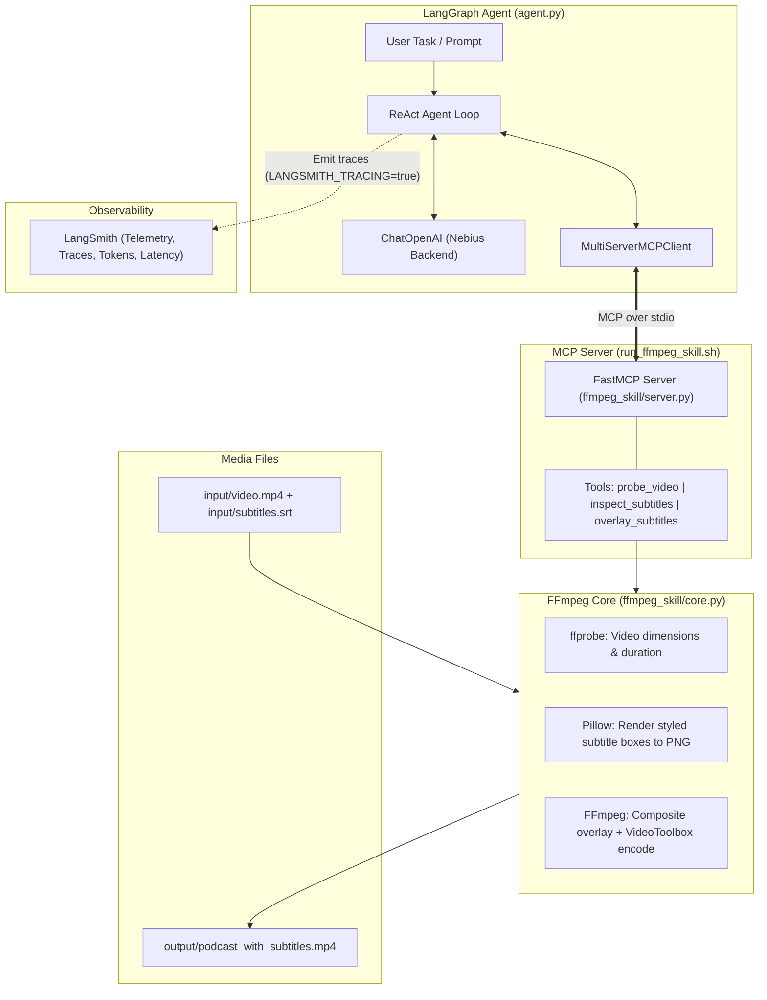
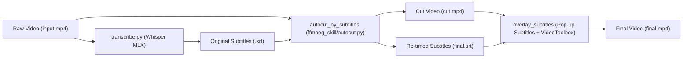

# Autonomous Podcast Subtitle-Overlay Agent

An autonomous video-editing agent that burns styled subtitles onto a podcast
video. A **LangGraph** ReAct agent, backed by a **Nebius** LLM, plans the edit
and calls an **ffmpeg-skill MCP server** to do the actual rendering with
**FFmpeg + Apple VideoToolbox**.

This implements the "Autonomous agent" + "overlay subtitles" ideas from
[`docs/podcast_mcp_automated_video_editing_guide.md`](docs/podcast_mcp_automated_video_editing_guide.md),
adapted to what actually runs on this machine (see
[Findings](#findings--implementation-notes)).

---

## TL;DR — run the full pipeline on a video

One-time setup (see [Setup](#setup) for details):

```bash
VIRTUAL_ENV=.venv uv pip install -r requirements.txt   # deps (ffmpeg via brew)
cp .env.example .env                                   # add your NEBIUS_API_KEY
```

Then run the whole thing — **transcribe → auto-cut silence → overlay pop-ups** —
with one command:

```bash
.venv/bin/python scripts/pipeline.py --input input/video1772263817.mp4 --output-dir output
```

Result: `output/<video_name>/<video_name>_final.mp4` — no-speech gaps removed
and subtitles burned in with per-shot adaptive colours. Everything the
pipeline produces for one video lives in its own subdirectory named after
the video:

```
output/<video_name>/
  <video_name>_final.mp4           # the finished video
  <video_name>_cut.mp4            # after auto-cut, no subtitles
  <video_name>.srt                # original transcript
  <video_name>_final_timecodes.md # 5-6 key moments (Nebius sub-agent)
  screenshots/00000000s.jpg ...     # one frame of the INPUT video every 2s,
                                     # named by its timestamp in seconds
```

The re-timed `<video_name>_final.srt` is an internal intermediate: it is
deleted after the burn by default (players auto-load same-basename `.srt`
files and would show captions twice next to the burned-in ones); pass
`--keep-srt` to keep it for downstream tools (e.g. `shorts_creator.py` on
the final video).

Handy flags:

| Flag | Default | Meaning |
|------|---------|---------|
| `--input, -i` | required | Input video. |
| `--output-dir, -o` | `output` | Where all artifacts are written. |
| `--language, -l` | `en` | Spoken language: `en` or `ru`. |
| `--style, -s` | `designer` | `designer` / `adaptive` / `modern_box` / `youtube_pop`. |
| `--no-autocut` | off | Skip the silence-removal stage. |
| `--skip-autocut` | off | Fast mode: only the transcript `.srt` and `screenshots/` are produced — no auto-cut, no burn-in, no timecodes, nothing re-encoded. |
| `--no-timecodes` | off | Skip the key-moments timecode agent (stage 4). |
| `--keep-srt` | off | Keep the re-timed `<stem>_final.srt` (deleted by default — subtitles are burned in). |
| `--no-screenshots` | off | Skip the input-video screenshots (stage 5). |
| `--screenshot-interval` | `2` | Seconds between screenshots of the input video. |
| `--trim SECONDS` | off | Render only the first N seconds (fast preview). |
| `--overwrite` | off | Re-transcribe even if the `.srt` exists. |

Fast preview, no cutting:

```bash
.venv/bin/python scripts/pipeline.py -i input/video1772263817.mp4 -o output --no-autocut --trim 20
```

While a stage runs, an animated spinner (`common/progress.py`) shows the message,
elapsed time and — during the FFmpeg re-encodes (auto-cut, overlay) — a live
completion percentage parsed from ffmpeg's `-progress` output. On
non-interactive terminals the spinner stays silent and messages degrade to
plain log lines.

Prefer the autonomous agent to drive it in natural language? See
[Run the full agent](#run-the-full-agent-nebius--mcp--ffmpeg).

---

## The whole pipeline, step by step

From a raw lecture recording to a finished video, key moments, OCR'd slides,
a phrase buffer and vertical Shorts. Every step consumes the previous
step's output and is re-runnable (each tool skips work that is already done,
unless you pass `--overwrite`).

### Step 0 — one-time setup

```bash
VIRTUAL_ENV=.venv uv pip install -r requirements.txt   # Python deps (ffmpeg via brew)
cp .env.example .env                                   # add your NEBIUS_API_KEY
```

### Step 1 — process the video (`pipeline.py`)

Transcribes the speech, removes no-speech gaps, burns in styled subtitles,
picks key moments and captures a screenshot every 2 seconds — all into
`output/<video_name>/`:

```bash
.venv/bin/python scripts/pipeline.py --input input/talk.mp4 --output-dir output
```

Artifacts after this step:

```
output/talk/
  talk_final.mp4            # the finished video (subs burned in)
  talk_cut.mp4              # after auto-cut, no subtitles
  talk.srt                  # original transcript (original timeline)
  talk_final_timecodes.md   # 5-6 key moments on the final timeline
  screenshots/00000000s.jpg # frames of the INPUT video, named by timestamp
```

Notes:
- Russian audio? add `--language ru`.
- `--trim 30` renders a 30-second preview first to check the style before
  committing to the full encode.
- Planning Step 5 (Shorts from the **final** video)? add `--keep-srt` so the
  re-timed `talk_final.srt` survives for it (otherwise it is deleted after
  the burn).
- Only want the transcript and screenshots (no re-encoding at all)?
  `--skip-autocut` is a fast mode that does exactly that.

### Step 2 — OCR the screenshots (`ocr.py`)

Sends each screenshot to the vision model and writes the transcription next
to it as `{SCREENSHOT_NAME}.md`:

```bash
.venv/bin/python scripts/ocr.py --input output/talk
```

**Restore mode** (default): a screenshot whose `.md` already exists is
skipped with **no API call** — an interrupted run is resumed by repeating
the same command (`--overwrite` re-OCRs everything). With `--auto-crop` the
detected rectangle is cached in `screenshots/crop_rect.json` and restored on
the next run instead of re-detecting (delete that file to re-detect).
Requests run **5 in parallel** by default (`--parallel N`, 1 = sequential).

Screenshots of a **browser** (player inside a page)? `--auto-crop` detects
the player-window rectangle first: up to 10 random shots (5 in parallel) are
sent to the vision model, the median answer is used to crop every screenshot
**in memory** before OCR — browser chrome, sidebars and recommendation lists
stay out of the transcript, and the `.jpg` files are not modified. When the
flag is omitted and there is OCR work to do, you are asked interactively
(`y/N`, default N — accepted: y/yes/д/да).

### Step 3 — summarize the OCR into a phrase buffer (`iterative_summarizer.py`)

Walks the OCR `.md` files chronologically, keeps a running buffer of distinct
phrases (one prompt per file: "extract the phrases, return only what is NOT
already in the buffer") and writes the final buffer to
`output/talk/talk_phrases.md`. As a **last step**, one more prompt turns the
buffer into a structured study document `talk_phrases_structured.md`:
phrases grouped under `# <Theme>` headings, each as a `## <n>. <phrase>`
subsection with bullets for the English origin, the Hungarian translation
and an English-respelled pronunciation (`yo REH-gelt`):

```bash
.venv/bin/python scripts/iterative_summarizer.py --input output/talk
```

Identical screenshots (an unchanged slide) cost no LLM call at all.
**Restore mode**: progress is checkpointed after every file, so an
interrupted run resumes where it stopped — already-summarized files cost no
API call.

### Step 4 — (optional) key moments are already there

`talk_final_timecodes.md` from Step 1 lists the 5-6 key moments with
timestamps on the final video's timeline — handy as YouTube chapters.

### Step 5 — make Shorts (`shorts_creator.py`)

Cuts the most engaging moments into ~90s vertical 9:16 clips with burned-in
pop-up subtitles and auto speed-up for slow speakers:

```bash
# from the ORIGINAL video (use the original transcript)
.venv/bin/python scripts/shorts_creator.py \
    --input input/talk.mp4 --srt output/talk/talk.srt \
    --output-dir output/talk/shorts --count 3 --duration 90

# or from the FINAL (gap-free) video — needs Step 1 run with --keep-srt
.venv/bin/python scripts/shorts_creator.py \
    --input output/talk/talk_final.mp4 --srt output/talk/talk_final.srt \
    --output-dir output/talk/shorts --count 3 --duration 90
```

Each Short lands in the output dir with its own manifest entry
(`<video>_shorts_manifest.json`); the `.srt` sidecars are removed by default
(subtitles are burned in — `--keep-srt` keeps them).

### Cheat sheet

| I want...                                     | Command                                                                  |
|-----------------------------------------------|--------------------------------------------------------------------------|
| everything, one command                       | `pipeline.py -i video.mp4 -o output`                                      |
| only transcript + screenshots (fast)           | `pipeline.py -i video.mp4 -o output --skip-autocut`                      |
| a quick style preview                         | `pipeline.py -i video.mp4 -o output --trim 30`                           |
| slide text next to every screenshot           | `ocr.py -i output/<video>` (+ `--auto-crop` for browser recordings)      |
| a deduplicated list of slide phrases          | `iterative_summarizer.py -i output/<video>`                              |
| mp3 chunks of "phrase + translation"          | `chunk_phrases.py -i course.srt` (language-course audio)                 |
| vertical Shorts                               | `shorts_creator.py -i video.mp4 -t subs.srt -o out -n 3`                |

---

## Architecture



### Subtitle generation (optional, upstream of the agent)



`transcribe.py` produces an `.srt` from a video's speech (so you are not
limited to the hand-written `input/subtitles.srt`). The optional
`autocut_by_subtitles` stage then uses that `.srt` as a speech map to remove
silent gaps and emit a re-timed `.srt`. Both plug straight into the overlay
agent.

### LangSmith Tracing & Observability

The pipeline integrates with **LangSmith** for full execution tracking, debugging, and latency/cost analysis:

* **LangGraph Agent Tracing (`scripts/agent.py`)**: Automatic out-of-the-box telemetry. When `LANGSMITH_TRACING=true` is set, every ReAct agent turn, tool call payload, output message, token count, and latency is logged to the configured project.
* **OpenAI SDK Tracing (`examples/nebius_interaction.py`)**: Uses LangSmith's `wrap_openai` client wrapper and `@traceable` function decorators for fine-grained tool and chain observability against Nebius endpoints.
* **Configuration** (in `.env`):
  ```bash
  LANGSMITH_TRACING=true
  LANGSMITH_ENDPOINT=https://api.smith.langchain.com
  LANGSMITH_API_KEY=lsv2_pt_...
  LANGSMITH_PROJECT=aieverything_workshop
  ```
* **Dashboard**: Traces can be inspected directly in your LangSmith organization under the **Tracing** section (`Projects > aieverything_workshop`).

### Project layout

The root only holds configuration and docs; everything else lives in
role-based subdirectories (see `docs/refactoring_plan.md`). Scripts include a
two-line `sys.path` bootstrap, so they run from anywhere — both as files and
as modules (`python -m scripts.pipeline ...`).

```text
nebius_workshop/
├── scripts/                    # CLI task runners + the MCP startup script
│   ├── run_ffmpeg_skill.sh
│   ├── pipeline.py, agent.py, shorts_creator.py, transcribe.py
│   ├── ocr.py, iterative_summarizer.py, chunk_phrases.py
├── examples/                   # standalone educational scripts
│   └── nebius_interaction.py
├── agents/                     # LLM agents & sub-agents (orchestrator, design, timecodes, highlights)
├── ffmpeg_skill/               # media processing engine & MCP server
├── common/                     # shared utilities (client, progress, text)
├── docs/                       # guides and plans
├── input/  ·  output/          # source media · rendered artifacts
├── requirements.txt  ·  README.md  ·  .env.example
```

### Components

| File / Package | Role |
|----------------|------|
| `scripts/agent.py` | LangGraph ReAct agent CLI runner. Connects to the MCP server over stdio and executes the editing task. |
| `agents/` | AI Sub-Agents package: `orchestrator.py` (ReAct loop), `design.py` (color palette), `timecodes.py` (chapters), `highlights.py` (Shorts finder). |
| `common/` | Shared cross-cutting utilities: `client.py` (Nebius & Vision LLM factory), `text.py` (formatters, transcript builder), `progress.py` (terminal spinner). |
| `LangSmith` | Observability & tracing platform. Records agent trajectories, LLM tokens, latencies, and tool calls from `scripts/agent.py` and `examples/nebius_interaction.py`. |
| `scripts/run_ffmpeg_skill.sh` | Startup script for the MCP server; launches it with the project venv over stdio. |
| `ffmpeg_skill/server.py` | FastMCP server exposing three tools: `probe_video`, `inspect_subtitles`, `overlay_subtitles`. |
| `ffmpeg_skill/core.py` | Pure-Python FFmpeg/FFprobe/Pillow logic. No MCP or LLM dependency, so it is easy to test directly. |
| `scripts/pipeline.py` | One-command CLI chaining transcribe → auto-cut → overlay → timecodes. `--input` + `--output-dir`. |
| `scripts/shorts_creator.py` | Separate CLI: turn a talk + `.srt` into several ~90s vertical Shorts (Nebius highlight-finder picks the moments). See `docs/shorts_creator.md`. |
| `ffmpeg_skill/shorts.py` | Shorts cutting logic: cue-snapped windows, overlap dedupe, 9:16 reframe, manifest. |
| `scripts/ocr.py` | Vision-model OCR of the `screenshots/` (Kimi-K2.6): one `.md` per screenshot; `--auto-crop`, restore-safe, 5 parallel requests. |
| `scripts/iterative_summarizer.py` | Phrase buffer from the OCR `.md` files: one prompt per file, only NEW phrases appended, checkpointed/restore-safe. |
| `scripts/chunk_phrases.py` | Language-course audio: finds "phrase + translation" cues in an `.srt`, cuts them to `audio_chunks/*.mp3` and writes `chunks.md`. |
| `ffmpeg_skill/autocut.py` | Subtitle-driven auto-cut: removes no-speech gaps and writes a re-timed `.srt`. Intermediate stage before overlay. |
| `scripts/transcribe.py` | Standalone Whisper (MLX) script: video/audio → `.srt`, for `ru` or `en`. |
| `input/subtitles.srt` | Sample subtitle cues (0.5–18 s). |
| `examples/nebius_interaction.py` | Reference for the Nebius/OpenAI + LangSmith wiring (pre-existing). |

### Flow

1. The agent spawns the ffmpeg-skill MCP server via `run_ffmpeg_skill.sh`
   and loads its tools.
2. The Nebius model, driving a ReAct loop, calls:
   - `probe_video` → learns the frame size (1512×860) and duration.
   - `inspect_subtitles` → confirms cue count and timing.
   - `overlay_subtitles` → renders the result.
3. `overlay_subtitles` parses the `.srt`, rasterises each cue to a transparent
   PNG with Pillow, composites them onto the video with FFmpeg's `overlay`
   filter (one overlay per cue, gated by `enable='between(t,start,end)'`), and
   encodes with `h264_videotoolbox`.
4. Telemetry: when `LANGSMITH_TRACING=true` is enabled, all agent steps, tool invocations,
   and token metrics are streamed in real time to the LangSmith project.

---

## Findings / implementation notes

These are the real constraints discovered while building this on macOS
(Apple Silicon), and why the implementation differs from the guide.

### 1. This FFmpeg build has no libass and no drawtext

The Homebrew `ffmpeg` 8.0.1 on this machine is compiled **without**
`--enable-libass` and **without** `--enable-libfreetype`/`fontconfig`.
Checked with:

```bash
ffmpeg -hide_banner -buildconf   # no libass / freetype / fontconfig
ffmpeg -hide_banner -filters     # no `subtitles`, no `drawtext`
```

Consequence: **both** subtitle recipes from the guide fail here — the
`subtitles='...':force_style='...'` filter (libass) and the `drawtext`
caption filter.

**Workaround (the "overlay subtitles" approach):** render each subtitle cue to
a transparent PNG with **Pillow** (rounded, semi-transparent box + centred
text), then composite it with the always-available `overlay` filter. This needs
no libass and loads system `.ttf`/`.ttc` fonts directly (no fontconfig).

### 2. VideoToolbox quality is controlled by `-q:v`, not `-crf`

Hardware encoding uses `-c:v h264_videotoolbox -q:v 65`. VideoToolbox is
confirmed available (`h264_videotoolbox`, `hevc_videotoolbox`,
`prores_videotoolbox`).

### 3. Audio is re-encoded, not copied

The guide used `-c:a copy`. When trimming a preview (`-t`), stream-copying
audio can leave a truncated/!misaligned tail, so audio is re-encoded with
`aac` and `+faststart` is set for clean playback.

### 4. Full-length renders are slow — preview by default

The source video is ~14.7 min (881.72 s). Burning subtitles is a full
re-encode. The agent renders an **18-second preview** by default
(`trim_seconds: 18`) so the workshop loop stays fast. Remove `trim_seconds`
to render the whole video.

### 5. Pillow sizing must be integer

`multiline_textbbox` can return floats; box dimensions are cast to `int`
before `Image.new`, otherwise Pillow raises
`TypeError: 'float' object cannot be interpreted as an integer`.

### 6. Package management is `uv`, not `pip`

The venv has no `pip`; packages are installed with `uv pip install`
(the `uv` binary is at `~/.local/bin/uv`).

### 7. LangGraph deprecation (non-blocking)

`langgraph` 1.x logs that `create_react_agent` is moving to
`langchain.agents.create_agent`. It still works today; swap the import when
upgrading to LangGraph v2.

### 8. Colour adaptation needs a legibility guardrail

Letting an LLM pick subtitle colours is nice for aesthetics but risky for
readability, so the design sub-agent's output is never trusted blindly: every
palette is clamped to valid ranges and run through a WCAG contrast check in
code. If text/box contrast is below ~4.5:1 (or the response is malformed, or
the API is unavailable), the pipeline snaps text to near-white/near-black or
falls back to the deterministic tint. The LLM influences *style*; code
guarantees *legibility*. Palettes are also cached by quantised colour to keep
API usage low on long videos.

### 9. Auto-cut must re-time the subtitles

Cutting no-speech gaps shortens the video, so the original subtitle timestamps
no longer line up. `autocut_by_subtitles` therefore emits a **new `.srt`** whose
cues are remapped onto the cut timeline (each kept segment contributes its
duration as an offset). The overlay stage must use that re-timed `.srt`, not the
original — otherwise pop-ups drift out of sync. Cues are derived straight from
the subtitles (no separate silence detection), and short pauses below `min_gap`
are kept so the result does not feel choppy.

### 10. Whisper transcription uses MLX, not openai-whisper

On Apple Silicon the fastest local option is `mlx-whisper` (Metal backend),
matching the reference implementation. `transcribe.py` first extracts audio to
mp3 with ffmpeg, then calls `mlx_whisper.transcribe(..., language=...)`. The
first run downloads the model from Hugging Face (medium ≈ 1.5 GB); subsequent
runs are cached. A short clip transcribed with `whisper-tiny` was used to
verify the pipeline. Language is restricted to `ru` or `en`.

---

## Prerequisites

- **macOS / Apple Silicon** (for VideoToolbox; the pipeline also runs on other
  platforms if you change the encoder in `ffmpeg_skill/core.py`).
- **FFmpeg + ffprobe** on `PATH` (`brew install ffmpeg`).
- **Python 3.13** virtualenv at `.venv` (already present in this project).
- A **Nebius API key**.

---

## Setup

1. Install Python dependencies into the venv (uses `uv`):

   ```bash
   VIRTUAL_ENV=.venv uv pip install -r requirements.txt
   ```

2. Configure environment. Copy the example and fill in your keys:

   ```bash
   cp .env.example .env
   ```

   Relevant variables (see `.env.example`):

   | Variable | Required | Default |
   |----------|----------|---------|
   | `NEBIUS_API_KEY` | yes | — |
   | `NEBIUS_BASE_URL` | no | `https://api.tokenfactory.nebius.com/v1/` |
   | `NEBIUS_MODEL` | no | `zai-org/GLM-5.3-Flash` |
   | `LANGSMITH_*` | no | optional tracing |

---

## Run

### Run the full agent (Nebius → MCP → FFmpeg)

```bash
.venv/bin/python scripts/agent.py
```

This connects to the ffmpeg-skill MCP server, lets the Nebius model drive the
tools, and writes `output/podcast_with_subtitles.mp4` (an 18 s preview by
default). The transcript of the agent's tool calls is printed to stdout.

To render the **full** video, open `agent.py` and remove the
`trim_seconds: 18` line from the `task` string (or set it to `None`).

### Render directly, without the LLM (fast sanity check)

```bash
.venv/bin/python -c "
from ffmpeg_skill.core import overlay_subtitles
print(overlay_subtitles(
    input_video='input/video1772263817.mp4',
    srt_path='input/subtitles.srt',
    output_video='output/preview.mp4',
    style_preset='modern_box',   # or 'youtube_pop' / 'adaptive' / 'designer'
    trim_seconds=10,
))
"
```

### Generate subtitles from the video with Whisper

Transcribe speech to an `.srt` (Apple Silicon / MLX Whisper). Language must be
`ru` or `en`:

```bash
# English, write straight to the file the agent uses
.venv/bin/python scripts/transcribe.py \
    --input input/video1772263817.mp4 \
    --language en \
    --output input/subtitles.srt

# Russian audio
.venv/bin/python scripts/transcribe.py --input input/video1772263817.mp4 --language ru
```

Options:

| Flag | Default | Meaning |
|------|---------|---------|
| `--input, -i` | required | Video or audio file. |
| `--language, -l` | `en` | `ru` or `en`. |
| `--output, -o` | `<input>.srt` | Destination `.srt`. |
| `--model, -m` | `mlx-community/whisper-medium` | MLX Whisper model (use `whisper-tiny` for a fast test, `whisper-large-v3` for best quality). |
| `--min-chars` | `1` | Drop segments shorter than this many characters. |
| `--overwrite` | off | Regenerate even if the `.srt` exists. |

The first run downloads the model (medium ≈ 1.5 GB). Then run `agent.py` to
overlay the freshly generated subtitles.

### Auto-cut no-speech gaps (optional intermediate stage)

Use the subtitles as a speech map: keep the spoken parts (padded so words are
not clipped), drop long pauses, and get a tighter video plus a re-timed `.srt`
that matches the new timeline. Run it between transcription and overlay.

```bash
.venv/bin/python -c "
from ffmpeg_skill import autocut_by_subtitles
print(autocut_by_subtitles(
    'input/video1772263817.mp4', 'output/subs.srt',
    'output/cut.mp4', output_srt='output/final.srt',
    pad=0.25,      # seconds kept around each cue
    min_gap=0.7,   # only gaps this long or longer are removed
))
"
```

Then overlay onto the **cut** video using the **re-timed** `output/final.srt`
(it matches the final video's timeline).
`pad` guards against clipping words; `min_gap` controls how aggressive the cut
is (larger = fewer, longer removals).

### Create YouTube Shorts from the talk

A separate pipeline (`shorts_creator.py`, fully documented in
[`shorts_creator.md`](docs/shorts_creator.md)): it consumes an existing `.srt`, asks
a **Nebius highlight-finder sub-agent** for the most engaging moments, and cuts
each into a ~90-second clip — optionally vertical 9:16 (blurred background)
with burned-in subtitles. A `…_shorts_manifest.json` records every clip.

**Step 1 — transcribe the talk first** (the Shorts pipeline needs the `.srt`):

```bash
.venv/bin/python scripts/transcribe.py --input input/video1772263817.mp4 --language en \
    --output output/video1772263817.srt
```

**Step 2 — create the Shorts:**

```bash
# Typical: 3 vertical Shorts (~90s) with burned-in pop-up subtitles
.venv/bin/python scripts/shorts_creator.py \
    --input input/video1772263817.mp4 \
    --srt output/video1772263817.srt \
    --output-dir output/shorts \
    --count 3 --duration 90
```

The `.srt` must match the video's timeline: the transcript for the original
video, or `<stem>_final.srt` if you feed it the `<stem>_final.mp4` produced by
the main pipeline (whose silent gaps were already removed).

Options:

| Flag | Default | Meaning |
|------|---------|---------|
| `--input, -i` | required | Source video file. |
| `--srt, -t` | `<video stem>.srt` | Subtitle file (original timeline). |
| `--output-dir, -o` | `output/shorts` | Where clips + manifest are written. |
| `--count, -n` | `3` | Max number of Shorts to create. |
| `--duration, -d` | `90` | Target clip length in seconds. |
| `--style, -s` | `youtube_pop` | Subtitle style: `youtube_pop` / `designer` / `adaptive` / `modern_box`. |
| `--speed` | `auto` | Speaker speed-up: `auto` measures the speech rate from the `.srt` and speeds up slow speakers to ~160 wpm (capped at 1.3x, subtitles re-timed automatically); an explicit `1.0`–`2.0` forces a factor, `1.0` disables. Windows grow proportionally so clips stay on target length. |
| `--no-vertical` | off | Keep the original aspect ratio (skip the 9:16 reframe). |
| `--no-subs` | off | Do not burn subtitles into the clips. |
| `--keep-srt` | off | Keep the per-clip `.srt` (deleted by default — subtitles are burned in). |

Examples:

```bash
# Quick smoke test: 1 horizontal clip of 20s, no subtitle burn-in (fastest)
.venv/bin/python scripts/shorts_creator.py -i input/video1772263817.mp4 \
    -t output/video1772263817.srt -n 1 -d 20 --no-vertical --no-subs

# Vertical clips with per-shot adaptive subtitle colours
.venv/bin/python scripts/shorts_creator.py -i input/video1772263817.mp4 \
    -t output/video1772263817.srt -s designer
```

Output in `output/shorts/`:

```
video1772263817_short_01_<slug>.mp4   # finished Short (1080x1920)
video1772263817_short_01_<slug>.srt   # only with --keep-srt (subtitles are burned in)
...
video1772263817_shorts_manifest.json  # index of everything produced
```

If `--srt` is omitted, the CLI looks for `<video>.srt` next to the video. If
the highlight LLM is unavailable, evenly-spaced starts are used so it still
produces output.

### OCR the screenshots

`ocr.py` transcribes the `screenshots/` of a pipeline run with a vision model
(default `moonshotai/Kimi-K2.6`), writing the text next to each image as
`{SCREENSHOT_NAME}.md`.

```bash
.venv/bin/python scripts/ocr.py --input output/<video_name>
```

| Flag | Default | Meaning |
|------|---------|---------|
| `--input, -i` | required | Pipeline output dir (must contain `screenshots/`), or the screenshots dir itself. |
| `--parallel N` | `5` | How many vision requests run concurrently (1 = sequential). |
| `--auto-crop` | asked | Detect the player-window rectangle first and crop every screenshot to it (for browser recordings). If omitted, you are asked interactively when there is OCR work to do (y/N, default N). |
| `--overwrite` | off | Re-OCR everything (skipped `.md` files otherwise). |

**Restore mode** (default): a screenshot whose `.md` already exists is
skipped with **no API call** — an interrupted run is resumed by repeating the
same command. A failed image is also retried on the next run.

With `--auto-crop`, up to 10 random screenshots (5 requests in parallel) are
sent to the vision model to determine the main-content rectangle (the player
window); the median answer is used to crop every screenshot **in memory**
before OCR — browser chrome, sidebars and recommendation lists stay out of
the transcript, and the `.jpg` files are not modified. The rectangle is
cached in `screenshots/crop_rect.json` and restored on the next run (delete
that file to force re-detection).

Config in `.env`: `VISION_API_KEY` (falls back to `NEBIUS_API_KEY`),
`VISION_BASE_URL`, `VISION_MODEL`.

### Summarize the OCR into a phrase buffer

`iterative_summarizer.py` walks the OCR `.md` files chronologically and keeps
a running **buffer** of distinct phrases: one LLM prompt per file extracts the
meaningful phrases and returns **only the ones not already in the buffer**
(identical screenshots — an unchanged slide — are skipped without a call). The
final buffer is written to `<video_name>_phrases.md` next to `screenshots/`.

```bash
.venv/bin/python scripts/iterative_summarizer.py --input output/<video_name>
```

`--output` picks another destination; `--overwrite` regenerates.

The last step also produces `<stem>_phrases_structured.md` — the buffer as a
study document with `# <Theme>` sections, `## <n>. <phrase>` entries and
bullets for origin (english) / translation (Hungarian) / pronunciation
(English-respelled, e.g. `yo REH-gelt`). Restore-safe like everything else:
existing phrases are reused and the structured file is only (re)generated
when missing (or with `--overwrite`).

### Cut phrase chunks from language-course audio (`chunk_phrases.py`)

For language-course recordings (Hungarian ↔ English): scans an `.srt` for
cues that are a **phrase + its translation** — one side Hungarian (detected
by its diacritics), the other plain English/Latin, in either order, around a
delimiter (`— - : / | =`) or a sentence boundary — and cuts each cue's audio
from the source media into mp3 chunks plus a phrase list:

```bash
.venv/bin/python scripts/chunk_phrases.py --input ~/Documents/hungarian/hungarian_1.srt
# -> audio_chunks/001_jó-reggelt.mp3 ... + chunks.md (phrase | translation | mp3 link)
```

The media is auto-detected next to the `.srt` (same-stem `.mp3`/`.mp4`/`.mov`/…,
as `extract_audio` leaves it) or passed via `--media`. `--output` changes the
destination dir (default: the `.srt`'s dir); existing mp3s are not re-cut
(`--overwrite` forces). Cues longer than 30s or shorter than 0.4s are ignored.
Tuned for course material: run it on a language-course `.srt`, not on lecture
transcripts (short plain/plain delimiter pairs like "RAG — retrieval
augmented generation" would be chunked too).

### Start the MCP server on its own

Useful to confirm it boots or to attach another MCP client:

```bash
./scripts/run_ffmpeg_skill.sh
# waits on MCP stdio; Ctrl-C to exit
```

---

## MCP tools reference

The ffmpeg-skill server exposes four tools:

| Tool | Arguments | Returns |
|------|-----------|---------|
| `probe_video` | `path` | `{width, height, duration}` |
| `inspect_subtitles` | `srt_path` | `{srt_path, cue_count, preview[]}` |
| `autocut_by_subtitles` | `input_video`, `srt_path`, `output_video`, `output_srt=None`, `pad=0.25`, `min_gap=0.7` | summary with `segments_kept`, `removed_seconds`, `cut_duration`, `output_video`, `output_srt` |
| `overlay_subtitles` | `input_video`, `srt_path`, `output_video`, `style_preset="modern_box"`, `trim_seconds=None` | summary dict with `output_video`, `cues_rendered`, `video_size`, `duration` |

**Style presets:**
- `modern_box` — white text on a semi-transparent dark rounded box (default).
- `youtube_pop` — bold yellow text with a black outline.
- `adaptive` — box tinted per shot to the scene's dominant colour, by a
  deterministic darken-the-dominant rule (offline, no LLM).
- `designer` — a Nebius **design sub-agent** chooses each shot's palette using
  colour-pairing theory (see below).

### Colour adaptation & the design sub-agent

The default look is a dark grey box with white text. Two presets make the box
harmonise with each shot while keeping that dark-box / light-text feel:

1. For every cue, `core.py` samples the **dominant colour** of the frame region
   behind the subtitle (crop the bottom-centre band, scale to 1×1 → the average
   pixel).
2. That colour is turned into a palette:
   - `adaptive` uses a deterministic rule: darken the dominant colour to ~32 %
     brightness (keeps the hue, stays readable), white or black text by
     luminance.
   - `designer` asks `ffmpeg_skill/design_agent.py` — a small Nebius LLM agent
     whose prompt encodes basic colour theory: legibility first (WCAG AA ≈
     4.5:1), put colour in the box not the text, harmonise via a darkened tint /
     analogous / complementary-accent, avoid clashing pairs, keep the box
     semi-transparent. Its JSON output is clamped and contrast-checked in code,
     so a bad or missing LLM response falls back to the deterministic palette —
     rendering never breaks.
3. To keep a long video cheap, the design agent **caches** results by a
   quantised colour (16-step buckets), so 128 cues make only a handful of calls.

Through the agent you can just ask in natural language, e.g. *"overlay the
subtitles and make them blend with each shot's colours"* — the model will pick
the `designer` preset.

---

## Using your own subtitles

Either hand-write `input/subtitles.srt`, or generate it from the video's audio
with `transcribe.py` (see
[Generate subtitles from the video with Whisper](#generate-subtitles-from-the-video-with-whisper)).
Any SubRip file works (`index`, `HH:MM:SS,mmm --> HH:MM:SS,mmm`, text); the
parser tolerates missing index lines and both `,` and `.` as the millisecond
separator. After generating the `.srt`, run the agent as usual.
